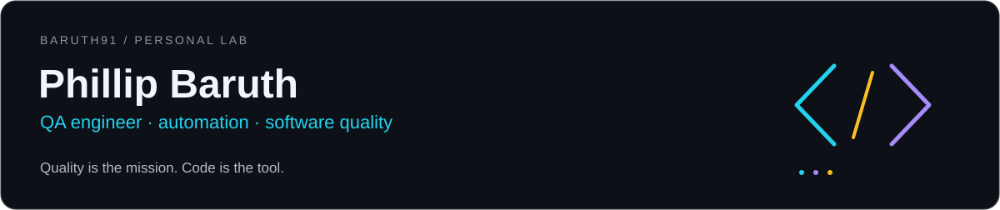

<p align="center">
  
</p>

<p align="center">
  <strong>Quality is the mission. Code is the tool.</strong><br />
  QA engineer · software development · player mindset
</p>

### > player profile

I'm Phillip Baruth, a QA professional with **12 years of experience in software quality assurance**.

This is where I build and share personal projects in QA and software development: turning ideas into code, investigating behavior, and exploring ways to build better software.

A gamer and a nerd at heart. Curious about how things work and what happens when they don't work as expected.

### > personal lab

I'm building the next chapter of my personal portfolio. Here's what I'll be sharing:

- **QA in practice:** test scenarios, investigations, and documentation for my own projects.
- **Code and experiments:** personal applications and tools for exploring ideas.
- **Continuous learning:** lessons and decisions documented along the way.

### > operating principles

```text
01  Understand the behavior before validating the outcome.
02  Explore beyond the happy path.
03  Turn findings into improvements.
04  Build, test, learn. Repeat.
```

<p align="center">
  <sub>Personal projects and independent learning. This profile does not represent employers or clients.</sub>
</p>
