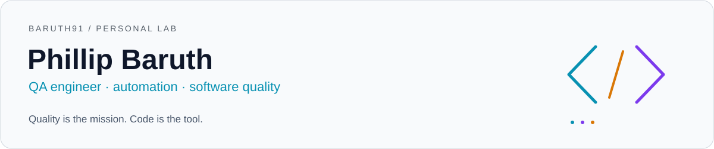

<picture>
  <source media="(prefers-color-scheme: dark)" srcset="assets/header.svg" />
  
</picture>

I'm **Phillip Baruth**, a QA engineer with **12 years of experience in software quality assurance**.

I turn quality risks into readable tests and share the decisions behind the code.
This is my personal lab for test automation, programming and learning in public.

### Languages and automation

Tools used in the case studies below. Follow a badge to see the implementation.

  
  
  
  

  
  
  
  
  

  
  
  

### Featured case studies

**[Expense review and stale decisions](https://github.com/baruth91/selenium-csharp-qa-case-study)** · Selenium / C# / NUnit / ASP.NET Core 
Nine real-browser cases: row identity, exact totals, filters, rejection evidence and optimistic concurrency. A specific mutation proves stale approvals are detected with browser diagnostics. [Verified CI](https://github.com/baruth91/selenium-csharp-qa-case-study/actions/runs/40775613588).

**[SOAP transfer integrity](https://github.com/baruth91/soapui-soap-qa-case-study)** · SoapUI / SOAP / XML / Java 
Versioned WSDL, namespace-aware XPath, exact money movement, idempotent retries and faults with unchanged state. 13 cases / 296 assertions, plus a verified missing-debit regression. [Verified CI](https://github.com/baruth91/soapui-soap-qa-case-study/actions/runs/40773900067).

**[Object ownership and API security](https://github.com/baruth91/api-security-zap-python-case-study)** · Python / pytest / OWASP crAPI / ZAP 
Real Java service, two-account authorization matrix, known BOLA reproduction and a scoped controller correction. Passive scanner results are interpreted alongside explicit ownership checks. [Execution evidence](https://github.com/baruth91/api-security-zap-python-case-study/blob/main/docs/validation.md).

**[Shopping journey](https://github.com/baruth91/playwright-python-qa-case-study)** · Playwright / Python / pytest 
Risk-based selection, cart arithmetic, browser/API checks and traces. [Execution scope](https://github.com/baruth91/playwright-python-qa-case-study/blob/main/docs/validation.md).

**[Transaction integrity](https://github.com/baruth91/cypress-typescript-qa-case-study)** · Cypress / TypeScript 
Controlled data, network synchronization, persisted transactions and exact balance changes. [Verified CI](https://github.com/baruth91/cypress-typescript-qa-case-study/actions/runs/40697835286).

**[Owner-record workflows](https://github.com/baruth91/selenium-java-qa-case-study)** · Selenium / Java / JUnit / Maven 
Record identity, input validation, explicit waits and browser lifecycle. [Verified CI](https://github.com/baruth91/selenium-java-qa-case-study/actions/runs/40706015776).

**[Order integrity](https://github.com/baruth91/postman-api-qa-case-study)** · Postman / JavaScript / HTTP 
Request chaining, exact totals, stock changes, access control and data-driven rejections against a local teaching API. [Verified CI](https://github.com/baruth91/postman-api-qa-case-study/actions/runs/40715919540).

**[Committed order data](https://github.com/baruth91/python-api-database-qa-case-study)** · Python / Requests / pytest / PostgreSQL 
Independent SQL observations, relational constraints, multi-item rollback and reconciliation queries that detect inconsistent totals. [Verified CI](https://github.com/baruth91/python-api-database-qa-case-study/actions/runs/40719981385).

**[AI-assisted QA evaluation](https://github.com/baruth91/ai-assisted-qa-evaluation-case-study)** · Python / pytest / Ollama 
Versioned prompts, real local-model responses, recorded replay and documented evaluator blind spots. [Harness CI](https://github.com/baruth91/ai-assisted-qa-evaluation-case-study/actions/runs/40766754597) · [Observed model failures](https://github.com/baruth91/ai-assisted-qa-evaluation-case-study/blob/main/docs/validation.md).

Each repository includes setup instructions, test rationale, learning exercises and
documented limits. Cypress and Selenium run their applications inside CI. The
Playwright case documents its separate local and hosted execution boundaries.
Postman runs a controlled in-memory API. The Python and PostgreSQL case extends the
domain with committed data, relational integrity and transaction rollback.

### How I approach quality

- Understand the behavior and risk before choosing what to automate.
- Verify meaningful outcomes, including persisted state where relevant.
- Keep tests independent and environments reproducible.
- Investigate failures with evidence and explain what a passing test cannot prove.

### Learning in public

These case studies are also my study material. I'm developing practical QA training
resources one explained example at a time, with code people can run and question.

Gamer at heart. Curious about how things work — and what happens when they don't.
**Build · test · learn · respawn.**

Personal projects and independent learning. This profile does not represent employers or clients.
